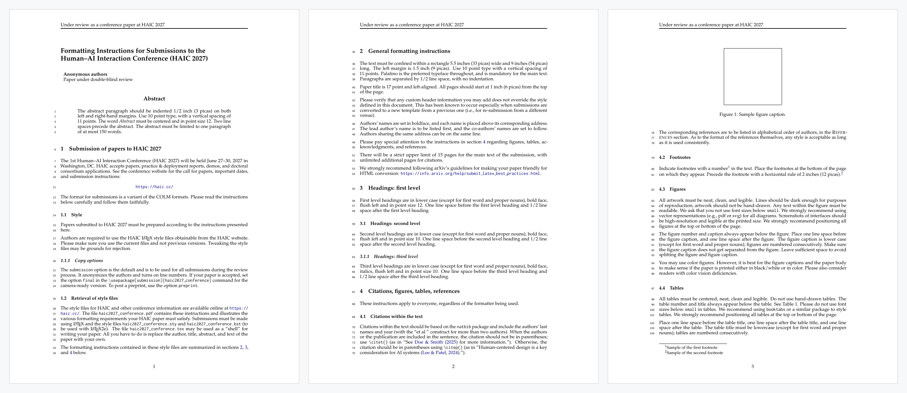

# HAIC 2027 LaTeX Template

LaTeX template and style files for submissions to the **1st Human–AI Interaction Conference (HAIC 2027)**, June 27–30, 2027, Washington, DC. See [haic.cc](https://haic.cc/) for the call for papers and important dates.



See [`haic2027_conference.pdf`](haic2027_conference.pdf) for the full example paper.

## Files

| File | Purpose |
|---|---|
| `haic2027_conference.tex` | Example paper. Use it as the starting point for your submission. |
| `haic2027_conference.sty` | HAIC style file. Do not modify it. |
| `haic2027_conference.bst` | Bibliography style (author–year, natbib). |
| `haic2027_conference.bib` | Example bibliography. Replace it with your own references. |
| `math_commands.tex` | Optional math macros. Include it with `\input{math_commands.tex}`. |
| `fancyhdr.sty`, `natbib.sty` | Supporting packages bundled for portability. |
| `haic2027_conference.pdf` | Compiled example paper. |

## Quick start

1. Copy this folder, or upload it to Overleaf as a new project from a `.zip` file.
2. Edit `haic2027_conference.tex`: replace the title, authors, abstract and body with your own.
3. Compile with pdfLaTeX and BibTeX:

   ```bash
   latexmk -pdf haic2027_conference.tex
   ```

   Or run the steps by hand: `pdflatex` → `bibtex` → `pdflatex` → `pdflatex`.

## Anonymous submission vs. camera-ready

The version is chosen by the option passed to the style file near the top of `haic2027_conference.tex`:

```latex
\usepackage[submission]{haic2027_conference}
```

| Option | Authors shown? | Running header | Line numbers | Use for |
|---|---|---|---|---|
| `submission` (default) | No ("Anonymous authors") | Under review as a conference paper at HAIC 2027 | Yes | **All submissions for review** |
| `preprint` | Yes | Preprint. Under review. | No | arXiv or other preprints |
| `final` | Yes | Published as a conference paper at HAIC 2027 | No | Camera-ready version of accepted papers |

- **Submitting for review:** keep `submission`. Fill in `\author{...}` as usual, because the style replaces the names with "Anonymous authors / Paper under double-blind review" automatically. Still check the PDF for anything else that identifies you, such as acknowledgments, self-citations written in the first person, or links to your own repositories.
- **Camera-ready:** change the option to `final`.
- **Content shown only in the final version:** wrap it in the provided conditional, for example:

  ```latex
  \ifhaicsubmission\else
  \section*{Acknowledgments}
  We thank ...
  \fi
  ```

  The flags `\ifhaicsubmission`, `\ifhaicpreprint` and `\ifhaicfinal` are all available.

## Authors

Separate authors with `\And` (LaTeX decides where to break the line) or `\AND` (forces a line break):

```latex
\author{First Author \\ Institution \\ \texttt{first@example.edu}
\And
Second Author \\ Institution \\ \texttt{second@example.org}}
```

## Acknowledgment

This template is adapted from the [COLM](https://colmweb.org/) template.
